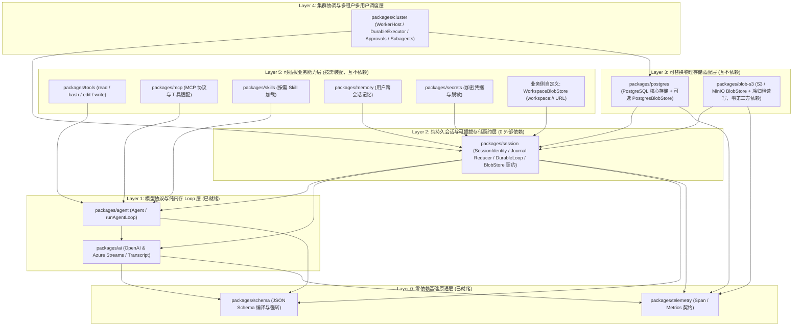

# 多租户多用户集群版 Agent Runtime (TS) 架构分层与完整 DDL 定稿设计

本文档基于全部评审结论与 `pi` 的工程哲学（**单文件单概念、严格单向依赖图、可插拔存储契约、纯追加事件流、克制状态机复杂度**），给出最终定稿的模块分层设计与 **完整 PostgreSQL 14+ DDL（11 张核心必建表 + 1 张按需可选扩展表）**。

> [!IMPORTANT]
> **定稿设计四大核心收敛**：
> 1. **11 张核心表职责极致单一**：移除 `agent_schema_migrations`（交由内部 DDL 平台纳管）、移除 `agent_audit_events`（改为零依赖可选 `AuditSink` 回调）、移除 `agent_tool_executions`（采用 `pi` 轻量中断诊断方案）、移除 `agent_session_snapshots`（采用 `context_start_seq` 聚簇索引窗口直读，**100% 消除快照双写与 PG MVCC/TOAST 表膨胀**）。
> 2. **全表贯通 `tenant_id` + `user_id` 双维度**：所有表均原生支持租户与用户两级隔离查询；`agent_quotas` 同时支持**租户总配额**、**租户内单用户默认上限**与**特定用户提额/熔断**。
> 3. **大对象存储可插拔解耦（`BlobStore`）**：核心层只认 `BlobRef { uri }`，内置零依赖 **S3 方案**与可选 **PG 兜底方案**（`agent_blobs`），支持 30 行代码平滑接入内部 **Workspace URL 存储**。
> 4. **明确冷热数据生命周期**：基于 `context_start_seq` 边界安全归档并物理删除历史旧事件，热表仅保留最近活跃窗口与轻量元数据，老会话随时免解压秒级续聊。

---

## 一、模块职责隔离与严格层级引用（Module DAG）

遵循 `pi` 的核心原则：**下层模块绝不感知上层概念，纯计算状态机与物理存储介质（PostgreSQL / S3 / Workspace）彻底解耦，单点导入绝不连带拉起未选用的存储驱动或集群调度器。**



### 各层职责与依赖红线

| 层级 | 包路径 | 唯一核心职责 | 允许依赖的内部包 | 允许的第三方运行时依赖 | 严禁出现的越界引用 |
|---|---|---|---|---|---|
| **L0** | `packages/schema` | JSON Schema 构造、大模型参数容错转换、零 `eval` 校验 | 无 | **无** | 严禁引用任何业务层或 `node:*` |
| **L0** | `packages/telemetry` | 链路追踪与指标抽象契约、`NOOP` 实现 | 无 | **无** | 严禁引用具体后端 SDK |
| **L1** | `packages/ai` | 多模型流式协议（OpenAI / Azure）、消息归一化、工具参数校验 | `schema`, `telemetry` | `openai` | **严禁感知 Session、租户、用户、数据库** |
| **L1** | `packages/agent` | 纯内存 `Agent` 与 `runAgentLoop`、队列、串并行工具与钩子 | `ai`, `schema` | **无** | **保持上游纯净，不塞数据库/租户逻辑** |
| **L2** | `packages/session` | **Durable 核心大脑（纯逻辑）**：`SessionIdentity { tenantId, userId, sessionId }`、事件 Tagged Union、滑动窗口确定性 Reducer、`DurableLoop`、工具 `replay: "safe"` vs `interrupted` 恢复规则、`BlobStore` / `AuditSink` 抽象契约、内存与本地 JSONL 实现 | `agent`, `ai`, `schema`, `telemetry` | **无**（仅 Node 内置 `fs/crypto`） | **严禁引用 `pg`、S3、Workspace、集群 Lease**；单测毫秒级纯内存跑通 |
| **L3** | `packages/postgres` | **PostgreSQL 多租户多用户存储实现**：Fencing 原子追加写入、`context_start_seq` 活跃窗口索引扫描、`SKIP LOCKED` 认领 SQL、租户+用户双层配额判定、计费投影；子路径导出可选 `PostgresBlobStore` | `session`, `telemetry` | `pg` | **严禁自动执行 DDL、严禁每次写入查 `to_regclass`、严禁内置后台定时器** |
| **L3** | `packages/blob-s3` | **S3 / MinIO 对象存储实现（按需装配）**：基于 Node 原生 `fetch` + `node:crypto` AWS SigV4 签名的 `S3BlobStore`（`s3://`）与冷归档对象读写 | `session`, `telemetry` | **无**（零 `@aws-sdk/*` 依赖） | **严禁依赖 `postgres` 或集群层** |
| **L4** | `packages/cluster` | **多 Worker 集群运行时**：`WorkerHost`（带退避重试的批量续租、父子隔离槽位池）、`DurableExecutor`（认领/恢复/毒丸熔断）、`DurableApprovals`、`DurableSubagents` + Outbox 投递器 | `session`, `postgres`, `agent`, `ai`, `telemetry` | **无**（可选注入外部唤醒回调与 `AuditSink`） | 严禁绕过 `postgres` 的 Fencing 接口直接改状态 |
| **L5** | `packages/tools` 及业务侧扩展 | 内置工具、MCP、Skill、Memory、Secrets、业务自定义的 `WorkspaceBlobStore` | `agent`, `ai`, `schema`（需隔离上下文的引 `session`） | 按子包隔离 | **严禁反向污染 L0–L4 核心层** |

---

## 二、全局并发、锁序与恢复四条铁律

1. **严格单向锁序（消除死锁）**：
   - **禁止跨 Session 事务锁**：任何事务最多只能锁定 **1 个 `session_id`**。子 Agent 完工通知父会话时，只向无行锁竞争的 `agent_outbox` 插入一条通知，**绝不在子事务里 `FOR UPDATE` 锁父会话**。
   - **单 Session 内固定锁序**：凡同时涉及租约与会话数据的写事务，严格按 `agent_session_leases` → `agent_sessions` → `agent_commands` → `agent_approvals` 顺序加锁；批量续租对输入的 `(tenant_id, session_id)` 升序排列后只更新 `agent_session_leases`。
2. **时间与 Fencing 唯一权威**：
   - 租约过期判定、续期、命令时间戳**全部在 SQL 内使用 PostgreSQL `clock_timestamp()`**，绝不信任 Worker 本地时钟。
   - `agent_session_leases` 行一旦创建**永不物理删除**；释放租约仅将 `expires_at` 置为 `clock_timestamp()`，下次抢占严格 `fence = fence + 1`。
   - 发起外部模型/工具请求前，若本地观测租约剩余有效时间 `< safetyMarginMs`（默认 5s），先完成一次同步续租再派发。
3. **纯追加零膨胀写入与 `context_start_seq` 窗口秒级加载**：
   - 工具 JSON Schema 与模型配置按 SHA-256 存入 `agent_session_configs`，事件里只存 64 字节 `config_hash`。
   - 若注入了 `BlobStore`（S3 / Workspace / PG），超过阈值（默认 64 KiB）的图片与长工具输出自动外置，事件中仅保存包含 `uri` 的轻量 `BlobRef`。
   - **不维护全量状态快照表**：`agent_sessions.context_start_seq` 指向当前活跃上下文窗口起点（随 `compaction` 或 `history_reset` 向前推进）。任何无状态 Worker 接手会话只需沿聚簇主键 `(tenant_id, session_id, seq >= context_start_seq)` 顺序读取最近几十条小事件（1~3ms），写入全程 100% 纯 `INSERT` 零 TOAST 死元组膨胀。
4. **`pi` 风格轻量工具恢复与审批 Park 闭环**：
   - 模型流结束时落盘 `model_completed`（持久化完整 `toolCalls` 意图列表），随后执行各工具并逐个落盘 `tool_completed`。框架自动计算确定性 `ctx.operationId`（`SHA-256(tenant_id, session_id, run_id, turn, call_id)` 前 128 bit）供工具按需透传下游幂等键。
   - 若工具执行中途 Worker 崩溃，恢复时已完成 `tool_completed` 的调用直接复用结果；未完成的调用若声明 `replay: "safe"` 则自动重跑，否则直接追加 `isError: true` 的 `interrupted` 诊断结果交由大模型下一轮审慎核查后再决策。
   - 遇到需人工审批的高危工具，落盘 `agent_approvals (status='pending')` 后**立即释放 `agent_session_leases` 与 Worker 并发槽位**；审批通过后经 `agent_outbox` 唤醒，任意空闲 Worker 抢占并校验 `action_hash` 后无缝执行。

---

## 三、完整 PostgreSQL DDL 与逐字段字典（共 11 张核心表 + 1 张可选表）

DDL 变更由内部数据库管理平台统一纳管，运行时不建迁移表、不自动执行 DDL、不在热路径做表探测。全套表划分为 **3 个核心子域**：

| 子域 | 表序号与表名 | 一句话核心定位 |
|---|---|---|
| **3.1 会话核心与冷热日志域**<br>（4 张核心表 + 1 张可选表） | `(1) agent_sessions`<br>`(2) agent_session_configs`<br>`(3) agent_session_events`<br>`(4) agent_session_archives`<br>`(可选 A) agent_blobs` | 会话主档、租户/用户归属与 `context_start_seq` 活跃窗口游标<br>模型配置与工具 JSON Schema 按哈希去重（防每轮重复落盘）<br>纯追加不可变事件流（承载上下文窗口、历史回溯与崩溃恢复）<br>早期历史事件（`seq < context_start_seq`）冷存储归档清单<br>*(仅选用 `PostgresBlobStore` 时创建的大对象兜底表)* |
| **3.2 集群协调、指令队列与审批域**<br>（4 张核心表） | `(5) agent_session_leases`<br>`(6) agent_commands`<br>`(7) agent_approvals`<br>`(8) agent_outbox` | 会话单活互斥锁与单调递增 `fence` 防脑裂令牌<br>多网关幂等入队、`SKIP LOCKED` 派发、插队保序、取消与毒丸熔断<br>高危工具动作级绑定审批单（支持挂起释放 Worker 与唤醒校验）<br>无锁跨会话异步通知（子 Agent 结果回报与审批唤醒，防父子死锁） |
| **3.3 多租户多用户配额与计费域**<br>（3 张核心表） | `(9) agent_quotas`<br>`(10) agent_runs`<br>`(11) agent_model_usage` | 租户总配额 + 租户内单用户上限 + 特定用户提额/熔断<br>每次运行生命周期摘要、父子调用树追踪与实时并发配额索引<br>物理 HTTP 模型调用 Token 明细与厂商账单对账 |

---

### 3.1 会话核心与冷热日志域

#### (1) `agent_sessions` —— 会话主档、归属隔离与活跃窗口游标表

**设计目的与作用环境**：
作为所有会话（根对话、子 Agent、Fork 分支）的唯一主档目录表，承载 `tenant_id` + `user_id` 权限隔离、用户会话列表分页、子任务递归深度限制、严格递增序号分配（`next_seq`）以及**模型活跃窗口游标（`context_start_seq`）**。无状态集群中任意 Worker 接手会话时，先读本表 1 行拿到 `context_start_seq` 和 `active_config_hash`，即可精准切片读取 `agent_session_events` 的最新活跃窗口，无需全量快照表。

```sql
CREATE TABLE agent_sessions (
    tenant_id text NOT NULL,
    session_id text NOT NULL,
    user_id text NOT NULL,
    root_session_id text NOT NULL,
    parent_session_id text,
    parent_event_id text,
    origin_kind text NOT NULL DEFAULT 'root'
        CHECK (origin_kind IN ('root', 'subagent', 'fork')),
    depth smallint NOT NULL DEFAULT 0 CHECK (depth >= 0),
    provider_session_id text NOT NULL,
    status text NOT NULL DEFAULT 'idle'
        CHECK (status IN ('idle', 'running', 'waiting_approval', 'archived')),
    active_run_id text,
    active_config_hash text,
    next_seq bigint NOT NULL DEFAULT 0 CHECK (next_seq >= 0),
    context_start_seq bigint NOT NULL DEFAULT 0
        CHECK (context_start_seq >= 0 AND context_start_seq <= next_seq),
    compaction_seq bigint
        CHECK (compaction_seq IS NULL OR (compaction_seq >= context_start_seq AND compaction_seq < next_seq)),
    archived_up_to_seq bigint NOT NULL DEFAULT -1
        CHECK (archived_up_to_seq >= -1 AND archived_up_to_seq < next_seq),
    metadata jsonb NOT NULL DEFAULT '{}',
    created_at timestamptz NOT NULL DEFAULT clock_timestamp(),
    updated_at timestamptz NOT NULL DEFAULT clock_timestamp(),
    PRIMARY KEY (tenant_id, session_id)
);

-- 某租户下某用户的历史会话列表分页查询（按创建时间倒序）
CREATE INDEX agent_sessions_user_created_idx
    ON agent_sessions (tenant_id, user_id, created_at DESC, session_id DESC);

-- 按租户扫描可归档候选会话（如长期未活跃或存在未归档旧窗口 context_start_seq > archived_up_to_seq + 1）
CREATE INDEX agent_sessions_tenant_updated_idx
    ON agent_sessions (tenant_id, updated_at ASC)
    WHERE status <> 'archived';

-- 查询某根会话派生的全部子 Agent 或 Fork 树
CREATE INDEX agent_sessions_root_idx
    ON agent_sessions (tenant_id, root_session_id);
```

| 字段 | 类型 | 说明 |
|---|---|---|
| `tenant_id` | `text` | 租户唯一标识，所有查询与外键的第一分区键 |
| `session_id` | `text` | 会话唯一标识（租户内唯一） |
| `user_id` | `text` | 会话归属用户 ID（创建后不可变；子会话与同用户 Fork 自动继承） |
| `root_session_id` | `text` | 根会话 ID；根会话自身等于 `session_id` |
| `parent_session_id` | `text` | 直接父会话 ID（仅 `subagent` 或 `fork` 时非空） |
| `parent_event_id` | `text` | 若为 `fork`，记录从父会话哪个 `event_id` 分叉而来 |
| `origin_kind` | `text` | 会话来源：`root`（普通根会话）、`subagent`（子任务会话）、`fork`（历史分支会话） |
| `depth` | `smallint` | 子 Agent 嵌套深度（根为 `0`，用于强制限制最大委派深度如 `maxDepth = 3`） |
| `provider_session_id` | `text` | 面向模型厂商的稳定 UUIDv7（跨节点恢复保持同一 OpenAI `prompt_cache_key`，Fork 时重新生成） |
| `status` | `text` | 会话宏观状态：`idle` / `running` / `waiting_approval` / `archived` |
| `active_run_id` | `text` | 当前未完结的 `run_id`（`idle` 时为 `NULL`） |
| `active_config_hash` | `text` | 当前生效的 `agent_session_configs.config_hash` |
| `next_seq` | `bigint` | 下一条待写入 `agent_session_events` 的严格连续序号（从 `0` 开始） |
| `context_start_seq` | `bigint` | **当前对大模型可见的活跃上下文起始事件 `seq`**（初始为 `0`；发生 `compaction` 时更新为 `first_kept_seq`，发生 `history_reset` 时更新为该重置事件 `seq`） |
| `compaction_seq` | `bigint` | 当前活跃窗口内生效的最近一次 `compaction` 事件序号（未压缩或刚 `history_reset` 后为 `NULL`） |
| `archived_up_to_seq` | `bigint` | 已完成冷归档并从 `agent_session_events` 热表物理删除的最大事件 `seq`（未归档为 `-1`） |
| `metadata` | `jsonb` | 业务侧扩展标签（如会话标题、项目 ID、Workspace 标识等，不进模型上下文） |
| `created_at`, `updated_at` | `timestamptz` | 创建时间与最后一次事件写入时间（纯读取不刷新 `updated_at`） |

---

#### (2) `agent_session_configs` —— 会话内模型与工具 Schema 内容寻址去重表

**设计目的与作用环境**：
专门用于**消除多轮对话中的持久化数据膨胀**。接入业务工具或 MCP 后，一套 `tools` JSON Schema 声明常达 50KB~200KB；按配置规范化 SHA-256（`config_hash`）在本表做 `ON CONFLICT DO NOTHING` 去重存储后，多轮事件中只记录 64 字节的 `config_hash` 引用，避免每轮对话重复写入整套工具定义。同时记录 `required_hooks`，防止新 Worker 接管恢复时漏配必选安全钩子。

```sql
CREATE TABLE agent_session_configs (
    tenant_id text NOT NULL,
    session_id text NOT NULL,
    user_id text NOT NULL,
    config_hash text NOT NULL,
    model_spec jsonb NOT NULL,
    tools_schema json NOT NULL,
    options jsonb NOT NULL DEFAULT '{}',
    required_hooks text[] NOT NULL DEFAULT '{}',
    created_at timestamptz NOT NULL DEFAULT clock_timestamp(),
    PRIMARY KEY (tenant_id, session_id, config_hash),
    FOREIGN KEY (tenant_id, session_id) REFERENCES agent_sessions ON DELETE CASCADE
);
```

| 字段 | 类型 | 说明 |
|---|---|---|
| `tenant_id`, `session_id`, `user_id` | `text` | 所属租户、会话与归属用户 ID |
| `config_hash` | `text` | `(model_spec, tools_schema, options, required_hooks)` 规范化后的 SHA-256 摘要 |
| `model_spec` | `jsonb` | 不含密钥/请求头的模型静态描述（`provider`, `id`, `api`, `baseUrl`, `reasoning`, `compat` 等） |
| `tools_schema` | `json` | 工具声明列表（含 `name`, `description`, `parameters`, `replay`），使用 `json` 兼容任意转义字符 |
| `options` | `jsonb` | 可持久化的采样与运行参数（如 `temperature`, `maxTokens`, `thinkingLevel`, `toolExecution`） |
| `required_hooks` | `text[]` | 创建运行时的必选钩子名列表；跨节点恢复时若宿主未注册同名钩子则拒绝盲目恢复 |
| `created_at` | `timestamptz` | 该配置首次在本会话中登记的时间 |

---

#### (3) `agent_session_events` —— 不可变追加式事件日志表（Canonical Journal）

**设计目的与作用环境**：
整个会话上下文、聊天历史与崩溃恢复的唯一权威账本（100% 纯 `INSERT` 追加，绝不原地 `UPDATE`）。
- **日常跨节点加载与崩溃恢复**：Worker 接手时执行 `SELECT seq, event_type, record FROM agent_session_events WHERE tenant_id = $1 AND session_id = $2 AND seq >= $3 ORDER BY seq ASC`（`$3 = context_start_seq`），沿聚簇主键一次顺序扫出最近一次压缩后的几十条活跃事件（耗时 1~3ms），并在内存中精确比对最后一轮 `model_completed` 与 `tool_completed` 完成断点恢复。
- **前端分页与任意节点 Fork**：支持前端按 `seq` 增量拉取消息流，以及按任意历史 `event_id` 分叉创建新会话。

```sql
CREATE TABLE agent_session_events (
    tenant_id text NOT NULL,
    session_id text NOT NULL,
    user_id text NOT NULL,
    seq bigint NOT NULL CHECK (seq >= 0),
    event_id text NOT NULL,
    run_id text,
    event_type text NOT NULL,
    fence bigint CHECK (fence IS NULL OR fence >= 1),
    record json NOT NULL,
    created_at timestamptz NOT NULL DEFAULT clock_timestamp(),
    PRIMARY KEY (tenant_id, session_id, seq),
    UNIQUE (tenant_id, session_id, event_id),
    FOREIGN KEY (tenant_id, session_id) REFERENCES agent_sessions ON DELETE CASCADE
);

-- 按单次 Run 快速拉取本次对话产生的事件明细
CREATE INDEX agent_session_events_run_seq_idx
    ON agent_session_events (tenant_id, session_id, run_id, seq)
    WHERE run_id IS NOT NULL;

-- 快速定位历史 Compaction 事件位置（供从远古节点 fork(eventId) 时回溯最近的压缩摘要）
CREATE INDEX agent_session_events_compaction_idx
    ON agent_session_events (tenant_id, session_id, seq DESC)
    WHERE event_type = 'compaction';
```

| 字段 | 类型 | 说明 |
|---|---|---|
| `tenant_id`, `session_id`, `user_id` | `text` | 所属租户、会话与归属用户 ID |
| `seq` | `bigint` | 会话内从 `0` 严格递增的无缺口序号 |
| `event_id` | `text` | 事件稳定唯一 ID（供消息溯源与按历史节点 `fork(eventId)` 使用） |
| `run_id` | `text` | 所属 `run_id`（会话级事件如 `session_created` / 空闲态手动 `compaction` 可为 `NULL`） |
| `event_type` | `text` | 显式事件类型：`session_created`, `run_started`, `messages_added`, `model_completed`, `tool_completed`, `turn_completed`, `run_paused`, `run_resumed`, `run_completed`, `run_interrupted`, `compaction`, `history_reset`, `session_forked` |
| `fence` | `bigint` | 写入该事件时 Worker 持有的 Lease `fence` 代数（导入/Fork 初始事件可为 `NULL`） |
| `record` | `json` | 结构化事件载荷（使用 `json` 兼容 `\u0000` 转义；超大图片与长文本已由 `BlobStore` 替换为轻量 `BlobRef`） |
| `created_at` | `timestamptz` | 事件落盘时间 |

---

#### (4) `agent_session_archives` —— 冷日志归档清单表（附全库冷归档范围矩阵）

**设计目的与作用环境**：
将已被 Compaction 淘汰出活跃上下文窗口之外的历史旧事件（`seq < context_start_seq`）或长期归档休眠会话打包为 `.jsonl.gz` 写入冷存储（S3 / MinIO / Workspace），回读校验 SHA-256 无误后，在本表登记归档区间并从 `agent_session_events` 热表物理删除，释放 90% 以上的数据库存储空间。当用户向上翻阅远古历史记录或从远古节点 `fork` 时，通过本表按 `[start_seq, end_seq]` 透明按需拉回。

##### 冷归档全表处理范围矩阵

| 处理策略 | 涉及表名 | 具体处理动作与原因 |
|---|---|---|
| **1. 导出至冷存并从 PG 物理删除**（释放 90%+ 热库容量） | `agent_session_events` *(及可选的 `agent_blobs`)* | 对活跃/空闲会话，将 `[archived_up_to_seq + 1, context_start_seq - 1]` 区间的历史事件打包为 `.jsonl.gz` 写入冷存 → 校验 SHA-256 → 同事务写入 `agent_session_archives`、推进 `archived_up_to_seq`、**物理 `DELETE` 对应 `agent_session_events` 热行**。活跃窗口 `seq >= context_start_seq` 的最近几十条事件保留在热表，确保老会话随时免解压秒级续聊。（若整会话超过如 180 天彻底休眠置为 `status = 'archived'`，也可将尾段一并归档）。 |
| **2. 无需归档、超保留期直接 TTL 清理**（运行期临时控制态） | `agent_commands`、`agent_outbox` | 最终业务事实已完整记录在 `agent_session_events` 与 `agent_runs` 中，无需上冷存：`agent_outbox` 已投递（`delivered`）记录保留 3~7 天直接 `DELETE`；`agent_commands` 已进入终态且满客户端幂等窗口（如 14~30 天）后直接批量 `DELETE`。 |
| **3. 常驻 PG 热库永不随日志归档删除**（极小体积元数据与计费事实） | `agent_sessions`、`agent_session_configs`、`agent_session_leases`、`agent_quotas`、`agent_runs`、`agent_model_usage`、`agent_approvals` | `sessions / configs / leases` 每会话仅占 1~2 行，常驻热库保证列表秒开与 `fence` 代数永不回退；`runs / model_usage / approvals` 是租户与用户的运营统计、Token 计费账单与审批合规凭据，独立常驻保证日志归档绝不影响历史账单与报表查询。 |

```sql
CREATE TABLE agent_session_archives (
    tenant_id text NOT NULL,
    session_id text NOT NULL,
    user_id text NOT NULL,
    start_seq bigint NOT NULL CHECK (start_seq >= 0),
    end_seq bigint NOT NULL CHECK (end_seq >= start_seq),
    object_uri text NOT NULL,
    version_id text,
    sha256 text NOT NULL,
    format_version smallint NOT NULL DEFAULT 1 CHECK (format_version = 1),
    run_ids text[] NOT NULL DEFAULT '{}',
    checkpoint_seqs bigint[] NOT NULL DEFAULT '{}',
    metadata jsonb NOT NULL DEFAULT '{}',
    created_at timestamptz NOT NULL DEFAULT clock_timestamp(),
    PRIMARY KEY (tenant_id, session_id, start_seq),
    FOREIGN KEY (tenant_id, session_id) REFERENCES agent_sessions ON DELETE CASCADE
);

CREATE INDEX agent_session_archives_user_created_idx
    ON agent_session_archives (tenant_id, user_id, created_at DESC);
```

| 字段 | 类型 | 说明 |
|---|---|---|
| `tenant_id`, `session_id`, `user_id` | `text` | 所属租户、会话与归属用户 ID |
| `start_seq`, `end_seq` | `bigint` | 该归档分块覆盖的闭区间事件序号 `[start_seq, end_seq]` |
| `object_uri`, `version_id` | `text` | 冷存储 URI（如 `s3://...` 或 `workspace://...`）与可选对象版本 ID |
| `sha256` | `text` | 归档文件 SHA-256 摘要，回读校验一致后才允许物理删除 `agent_session_events` 热行 |
| `format_version` | `smallint` | 归档文件编码格式版本 |
| `run_ids` | `text[]` | 该分块包含的 `run_id` 数组（支持 `ANY(run_ids)` 精准定位某次历史 Run 所在的归档包） |
| `checkpoint_seqs` | `bigint[]` | 该分块内包含的 `compaction` 事件序号列表，供冷数据按节点还原定位 |
| `metadata`, `created_at` | `jsonb`, `timestamptz` | 扩展信息（原始字节数、压缩后字节数等）与归档完成时间 |

---

### 3.2 集群协调、指令队列与审批控制域

#### (5) `agent_session_leases` —— 会话执行互斥租约与单调 Fencing 表

**设计目的与作用环境**：
解决多 Worker 集群下**“同一时刻同一会话最多只能有 1 个活跃执行者，且假死恢复的旧 Worker 绝不能覆盖新 Worker 状态（防脑裂）”**的核心锁表。每次租约过期被新节点抢占时 `fence` 严格 `+1`；任何写事件或改状态的 SQL 都必须校验 `fence` 匹配，彻底阻断旧节点的延迟脏写。

```sql
CREATE TABLE agent_session_leases (
    tenant_id text NOT NULL,
    session_id text NOT NULL,
    user_id text NOT NULL,
    holder text NOT NULL,
    fence bigint NOT NULL CHECK (fence >= 1),
    acquired_at timestamptz NOT NULL DEFAULT clock_timestamp(),
    renewed_at timestamptz NOT NULL DEFAULT clock_timestamp(),
    expires_at timestamptz NOT NULL,
    PRIMARY KEY (tenant_id, session_id),
    FOREIGN KEY (tenant_id, session_id) REFERENCES agent_sessions ON DELETE CASCADE
);

-- 扫描已过期的遗留租约
CREATE INDEX agent_session_leases_expires_idx
    ON agent_session_leases (expires_at ASC);

-- 按租户/用户观测活跃租约分布
CREATE INDEX agent_session_leases_user_idx
    ON agent_session_leases (tenant_id, user_id);
```

| 字段 | 类型 | 说明 |
|---|---|---|
| `tenant_id`, `session_id`, `user_id` | `text` | 租户、会话与归属用户 ID（1 会话最多 1 行） |
| `holder` | `text` | 当前持有者实例标识（如 `<pod-name>:<process-uuid>`） |
| `fence` | `bigint` | **单调递增代数令牌**（首次抢占为 `1`，每次重抢严格 `fence + 1`，永不删行、永不回退） |
| `acquired_at`, `renewed_at` | `timestamptz` | 本代 `fence` 获取时间与最近一次心跳续租成功时间 |
| `expires_at` | `timestamptz` | 租约到期时间；Worker 正常结束或进入审批挂起释放租约时置为 `clock_timestamp()` |

---

#### (6) `agent_commands` —— 会话输入指令队列与跨节点控制表

**设计目的与作用环境**：
在**无状态网关 + 多 Worker 集群**架构下，网关节点与实际执行会话的 Worker 节点分离，本表集中解决 4 个问题：
1. **接口幂等去重与可靠入队**：网关超时重试同一 `command_id` 时幂等返回原单，防重复执行/扣费；Worker 满载时消息先落库排队不丢失。
2. **免外部 MQ 的集群任务派发队列**：空闲 `WorkerHost` 通过 `FOR UPDATE SKIP LOCKED` 直接从本表公平认领待跑指令。
3. **运行期跨节点插队（`steer`）与追加（`follow_up`）严格保序**：运行中从任意网关写入的引导消息按 `command_seq` 递增排列，执行节点在步骤边界按序拉取注入 Loop。
4. **跨节点取消信令与“毒丸熔断”**：记录 `cancel_requested_at` 通知远端 Worker 中止；若某条异常输入反复引发 Worker 崩溃，累计 `recovery_attempts` 达上限（默认 3 次）后自动置为 `dead_letter` 熔断，保护集群不被单条毒消息打崩。

```sql
CREATE TABLE agent_commands (
    tenant_id text NOT NULL,
    command_id text NOT NULL,
    session_id text NOT NULL,
    user_id text NOT NULL,
    command_seq bigint NOT NULL CHECK (command_seq >= 1),
    kind text NOT NULL CHECK (kind IN ('prompt', 'steer', 'follow_up', 'continuation')),
    payload json NOT NULL,
    payload_hash text NOT NULL,
    run_id text,
    is_child boolean NOT NULL DEFAULT false,
    state text NOT NULL DEFAULT 'queued'
        CHECK (state IN ('queued', 'running', 'paused', 'completed', 'cancelled', 'failed', 'dead_letter')),
    recovery_attempts integer NOT NULL DEFAULT 0 CHECK (recovery_attempts >= 0),
    max_recovery_attempts integer NOT NULL DEFAULT 3 CHECK (max_recovery_attempts >= 1),
    cancel_requested_at timestamptz,
    cancel_reason text,
    last_error text,
    accepted_at timestamptz NOT NULL DEFAULT clock_timestamp(),
    started_at timestamptz,
    finished_at timestamptz,
    updated_at timestamptz NOT NULL DEFAULT clock_timestamp(),
    PRIMARY KEY (tenant_id, command_id),
    UNIQUE (tenant_id, session_id, command_seq),
    UNIQUE (tenant_id, session_id, run_id),
    FOREIGN KEY (tenant_id, session_id) REFERENCES agent_sessions ON DELETE CASCADE
);

-- 会话内严格 FIFO 队首定位与运行期 steer/follow_up 拉取
CREATE INDEX agent_commands_session_fifo_idx
    ON agent_commands (tenant_id, session_id, command_seq ASC)
    WHERE state IN ('queued', 'running', 'paused');

-- Worker 集群认领新任务与租户级公平排队索引（物理隔离根会话与子会话池）
CREATE INDEX agent_commands_claim_queued_idx
    ON agent_commands (is_child, tenant_id, accepted_at ASC, command_id ASC)
    WHERE state = 'queued' AND kind IN ('prompt', 'continuation');

-- 用户级排队积压计数索引（支撑单用户队列配额背压检查）
CREATE INDEX agent_commands_user_queued_idx
    ON agent_commands (tenant_id, user_id, accepted_at ASC)
    WHERE state = 'queued';

-- 崩溃遗留 running 任务（配合过期 Lease）的恢复扫描索引
CREATE INDEX agent_commands_recovery_running_idx
    ON agent_commands (is_child, updated_at ASC, tenant_id, command_id)
    WHERE state = 'running';
```

| 字段 | 类型 | 说明 |
|---|---|---|
| `tenant_id`, `command_id` | `text` | 租户 ID 与调用方幂等键（同 ID 重复提交返回原单；同 ID 不同 `payload_hash` 报 `409` 冲突） |
| `session_id`, `user_id` | `text` | 目标会话与发起该指令的用户 ID |
| `command_seq` | `bigint` | 会话内严格递增的命令入队序号 |
| `kind` | `text` | `prompt`（新轮输入）、`steer`（运行中插队）、`follow_up`（本轮后追加）、`continuation`（审批/子任务完成后投递的唤醒续跑指令） |
| `payload`, `payload_hash` | `json`, `text` | 不可变输入内容（不含凭据）及其规范化 SHA-256 摘要 |
| `run_id` | `text` | `prompt` 绑定的唯一 `run_id`（`steer` / `follow_up` 为 `NULL`，PG 标准 `UNIQUE` 允许多个 `NULL` 并存） |
| `is_child` | `boolean` | 是否为子 Agent 会话命令，供 `WorkerHost` 物理隔离父/子并发槽位防饥饿死锁 |
| `state` | `text` | `queued` / `running` / `paused`（等人工审批挂起，已释放 Lease） / `completed` / `cancelled` / `failed` / `dead_letter` |
| `recovery_attempts`, `max_recovery_attempts` | `integer` | 崩溃恢复累计次数与毒丸熔断上限（默认 `3`） |
| `cancel_requested_at`, `cancel_reason` | `timestamptz`, `text` | 跨节点持久化取消意图时间戳与原因 |
| `last_error` | `text` | 最近一次失败或熔断诊断摘要 |
| `accepted_at`, `started_at`, `finished_at`, `updated_at` | `timestamptz` | 入队、开跑、完结与最后更新时间 |

---

#### (7) `agent_approvals` —— 动作级精确绑定人工审批单表（支持释放 Worker 挂起唤醒）

**设计目的与作用环境**：
当 Agent 触发高危工具需要人工审批时，避免 Worker 协程在内存里空等数小时占死槽位。本表将该次工具调用冻结为绑定确定性 `operation_id`、`call_id` 与参数哈希 `action_hash` 的持久化审批单，写库后**立即释放会话 Lease 与 Worker 槽位**；审批人做出决定后经 `agent_outbox` 唤醒会话，任意健康 Worker 接手并校验 `action_hash` 一致后安全执行。

```sql
CREATE TABLE agent_approvals (
    tenant_id text NOT NULL,
    approval_id text NOT NULL,
    session_id text NOT NULL,
    user_id text NOT NULL,
    run_id text NOT NULL,
    operation_id text NOT NULL,
    call_id text NOT NULL,
    approver_id text NOT NULL,
    tool_name text NOT NULL,
    action_payload json NOT NULL,
    action_hash text NOT NULL,
    context jsonb NOT NULL DEFAULT '{}',
    status text NOT NULL DEFAULT 'pending'
        CHECK (status IN ('pending', 'approved', 'rejected', 'expired', 'consumed')),
    decided_by text,
    decision_reason text,
    created_at timestamptz NOT NULL DEFAULT clock_timestamp(),
    expires_at timestamptz NOT NULL,
    decided_at timestamptz,
    consumed_at timestamptz,
    PRIMARY KEY (tenant_id, approval_id),
    UNIQUE (tenant_id, operation_id),
    FOREIGN KEY (tenant_id, session_id) REFERENCES agent_sessions ON DELETE CASCADE
);

-- 审批工作台视角：查询某审批人（或审批组）名下的待审批单
CREATE INDEX agent_approvals_pending_approver_idx
    ON agent_approvals (tenant_id, approver_id, created_at DESC)
    WHERE status = 'pending';

-- 发起用户视角：查询某用户自己会话发起的审批记录
CREATE INDEX agent_approvals_user_created_idx
    ON agent_approvals (tenant_id, user_id, created_at DESC);

-- 超时扫描：将到期未批的单据自动置为 expired 并唤醒会话返回拒绝结果
CREATE INDEX agent_approvals_pending_expiry_idx
    ON agent_approvals (expires_at ASC)
    WHERE status = 'pending';
```

| 字段 | 类型 | 说明 |
|---|---|---|
| `tenant_id`, `approval_id` | `text` | 租户与审批单唯一 ID |
| `session_id`, `user_id`, `run_id` | `text` | 发起该审批的会话 ID、会话归属用户 ID 与运行 ID |
| `operation_id`, `call_id` | `text` | 确定性操作标识与模型 `toolCall.id`（1 张审批票据只能消费在唯一一个 `operation_id` 上） |
| `approver_id` | `text` | 目标审批人用户 ID 或审批组标识 |
| `tool_name`, `action_payload`, `action_hash` | `text`, `json`, `text` | 冻结的工具名、完整入参与 SHA-256 哈希；唤醒执行前强制二次校验 `action_hash` 一致 |
| `context` | `jsonb` | 供审批前端展示的业务上下文说明 |
| `status` | `text` | `pending`（待批）、`approved`（已批待消费）、`rejected`（已拒）、`expired`（超时失效）、`consumed`（已消费执行） |
| `decided_by`, `decision_reason` | `text` | 实际审批操作人 ID 与审批意见 |
| `created_at`, `expires_at`, `decided_at`, `consumed_at` | `timestamptz` | 创建、过期截止、做出决定、实际消费执行时间 |

---

#### (8) `agent_outbox` —— 无锁跨会话通知与异步唤醒投递表

**设计目的与作用环境**：
专门用于**消除跨会话锁竞争与父子死锁（Transactional Outbox 模式）**。子 Agent 完工通知父会话或外部审批完成唤醒挂起会话时，触发方在自己的事务内**绝不去 `FOR UPDATE` 锁目标会话**，仅向本表无锁 `INSERT` 一条通知即刻提交；后台投递协程通过 `FOR UPDATE SKIP LOCKED` 异步消费并转换为目标会话的 `continuation` 指令。

```sql
CREATE TABLE agent_outbox (
    message_seq bigint GENERATED ALWAYS AS IDENTITY PRIMARY KEY,
    tenant_id text NOT NULL,
    user_id text NOT NULL,
    message_id text NOT NULL,
    kind text NOT NULL CHECK (kind IN ('child_result', 'approval_decided', 'external_signal')),
    target_session_id text NOT NULL,
    source_session_id text,
    source_run_id text,
    payload jsonb NOT NULL,
    state text NOT NULL DEFAULT 'pending'
        CHECK (state IN ('pending', 'delivered', 'dead_letter')),
    attempts integer NOT NULL DEFAULT 0 CHECK (attempts >= 0),
    last_error text,
    available_at timestamptz NOT NULL DEFAULT clock_timestamp(),
    created_at timestamptz NOT NULL DEFAULT clock_timestamp(),
    delivered_at timestamptz,
    UNIQUE (tenant_id, message_id)
);

-- 投递器使用 FOR UPDATE SKIP LOCKED 批量拉取到期通知
CREATE INDEX agent_outbox_pending_dispatch_idx
    ON agent_outbox (available_at ASC, message_seq ASC)
    WHERE state = 'pending';

-- 按目标会话查看待处理唤醒信号
CREATE INDEX agent_outbox_target_session_idx
    ON agent_outbox (tenant_id, target_session_id, message_seq ASC)
    WHERE state = 'pending';
```

| 字段 | 类型 | 说明 |
|---|---|---|
| `message_seq` | `bigint IDENTITY` | 数据库原生无锁自增主键 |
| `tenant_id`, `user_id` | `text` | 目标会话所属租户与归属用户 ID |
| `message_id` | `text` | 幂等通知键（如 `child_done:<child_sid>:<run_id>`，防重复唤醒） |
| `kind` | `text` | `child_result`（子 Agent 完工回报）、`approval_decided`（审批结果唤醒）、`external_signal`（外部 Webhook 信号） |
| `target_session_id` | `text` | 接收唤醒的目标会话 ID |
| `source_session_id`, `source_run_id` | `text` | 来源子会话与子运行 ID（如适用） |
| `payload` | `jsonb` | 轻量引用载荷（仅传 ID 与状态摘要，不传大文本正文） |
| `state`, `attempts`, `last_error` | `text`, `integer`, `text` | 投递状态、失败重试次数与最后错误 |
| `available_at`, `created_at`, `delivered_at` | `timestamptz` | 下次可投递时间（支持指数退避重试）、创建时间、成功投递时间 |

---

### 3.3 多租户/多用户配额与运行计费域

#### (9) `agent_quotas` —— 租户级与用户级双层并发/排队配额表

**设计目的与作用环境**：
同时治理两层资源抢占问题：① **防某大租户占满集群影响其他租户**；② **防同一租户内某个员工高频并发把全公司额度吃光**。
- `scope_type = 'tenant'`（`user_id = ''`）：定义该租户的总并发/排队上限，以及租户内普通员工的默认单人上限（`per_user_max_*`）；置 `0` 可一键暂停整个租户。
- `scope_type = 'user'`（`user_id = '<具体用户ID>'`）：可选规则，对特定用户单独提额，或对异常用户置 `0` 单独熔断。未配置行时自动回退到 `WorkerHost` 全局默认配额兜底。

```sql
CREATE TABLE agent_quotas (
    tenant_id text NOT NULL,
    scope_type text NOT NULL CHECK (scope_type IN ('tenant', 'user')),
    user_id text NOT NULL DEFAULT '',
    max_active_root_runs integer NOT NULL CHECK (max_active_root_runs >= 0),
    max_active_child_runs integer NOT NULL CHECK (max_active_child_runs >= 0),
    max_queued_commands integer NOT NULL CHECK (max_queued_commands >= 0),
    per_user_max_active_root_runs integer
        CHECK (per_user_max_active_root_runs IS NULL OR per_user_max_active_root_runs >= 0),
    per_user_max_active_child_runs integer
        CHECK (per_user_max_active_child_runs IS NULL OR per_user_max_active_child_runs >= 0),
    per_user_max_queued_commands integer
        CHECK (per_user_max_queued_commands IS NULL OR per_user_max_queued_commands >= 0),
    updated_at timestamptz NOT NULL DEFAULT clock_timestamp(),
    PRIMARY KEY (tenant_id, scope_type, user_id),
    CHECK (
        (scope_type = 'tenant' AND user_id = '')
        OR (
            scope_type = 'user'
            AND user_id <> ''
            AND per_user_max_active_root_runs IS NULL
            AND per_user_max_active_child_runs IS NULL
            AND per_user_max_queued_commands IS NULL
        )
    )
);
```

| 字段 | 类型 | 说明 |
|---|---|---|
| `tenant_id` | `text` | 租户 ID |
| `scope_type` | `text` | `'tenant'`（租户级总规则 + 租户内单用户默认上限）或 `'user'`（特定用户级覆盖规则） |
| `user_id` | `text` | `'tenant'` 规则固定为 `''`；`'user'` 规则为具体用户 ID |
| `max_active_root_runs` | `integer` | 当前作用域允许同时处于 `running` 的最大根会话数 |
| `max_active_child_runs` | `integer` | 当前作用域允许同时处于 `running` 的最大子 Agent 数 |
| `max_queued_commands` | `integer` | 当前作用域允许积压的最大 `queued` 指令数（超限入口直接返回 `429`） |
| `per_user_max_*` | `integer` | 仅 `'tenant'` 规则可设：该租户下未单独配置 `'user'` 规则的默认单用户上限 |
| `updated_at` | `timestamptz` | 配额最后修改时间 |

---

#### (10) `agent_runs` —— 会话运行事实与父子任务树统计表

**设计目的与作用环境**：
记录每次 Agent 运行的结构化生命周期摘要。既配合 Partial Index 为 `agent_quotas` 提供亚毫秒级的租户/用户实时并发计数，又在 `agent_session_events` 历史冷归档删除后永久保留多租户/多用户运营统计与整棵父子调用树拓扑。

```sql
CREATE TABLE agent_runs (
    tenant_id text NOT NULL,
    session_id text NOT NULL,
    run_id text NOT NULL,
    command_id text,
    user_id text NOT NULL,
    root_run_id text NOT NULL,
    parent_session_id text,
    parent_run_id text,
    depth smallint NOT NULL DEFAULT 0 CHECK (depth >= 0),
    source text NOT NULL CHECK (source IN ('user', 'subagent', 'system')),
    status text NOT NULL
        CHECK (status IN ('running', 'waiting_approval', 'completed', 'cancelled', 'failed')),
    recovery_attempts integer NOT NULL DEFAULT 0 CHECK (recovery_attempts >= 0),
    started_at timestamptz NOT NULL,
    finished_at timestamptz,
    metadata jsonb NOT NULL DEFAULT '{}',
    PRIMARY KEY (tenant_id, session_id, run_id)
);

-- 实时统计某租户当前 running 的父/子任务数
CREATE INDEX agent_runs_tenant_active_idx
    ON agent_runs (tenant_id, source)
    WHERE status = 'running';

-- 实时统计某租户下某用户当前 running 的父/子任务数
CREATE INDEX agent_runs_user_active_idx
    ON agent_runs (tenant_id, user_id, source)
    WHERE status = 'running';

-- 按租户+用户+时间区间查询运行记录
CREATE INDEX agent_runs_user_started_idx
    ON agent_runs (tenant_id, user_id, started_at DESC, session_id DESC, run_id DESC);

CREATE INDEX agent_runs_user_finished_idx
    ON agent_runs (tenant_id, user_id, finished_at DESC)
    WHERE finished_at IS NOT NULL;

-- 按根任务汇总整棵父子调用树的所有子 Run
CREATE INDEX agent_runs_root_idx
    ON agent_runs (tenant_id, root_run_id, started_at ASC);
```

| 字段 | 类型 | 说明 |
|---|---|---|
| `tenant_id`, `session_id`, `run_id` | `text` | 复合主键（无外键级联删除，日志冷归档后永久保留） |
| `command_id`, `user_id` | `text` | 触发本次 Run 的 `command_id` 与归属用户 ID |
| `root_run_id` | `text` | 整棵任务树的根标识（格式 `<root_session_id>/<root_run_id>`） |
| `parent_session_id`, `parent_run_id`, `depth` | `text`, `text`, `smallint` | 直接父会话、直接父 Run 与深度（用于限制单次父 Run 派生子任务上限，如 32 个） |
| `source` | `text` | `user`（用户触发）、`subagent`（子 Agent）、`system`（后台任务如自动摘要/记忆整理） |
| `status` | `text` | `running` / `waiting_approval` / `completed` / `cancelled` / `failed` |
| `recovery_attempts` | `integer` | 本次运行经历的崩溃恢复次数 |
| `started_at`, `finished_at`, `metadata` | `timestamptz`, `jsonb` | 开始时间、结束时间与扩展统计摘要 |

---

#### (11) `agent_model_usage` —— 物理模型调用 Token 计费与对账表

**设计目的与作用环境**：
旁路记录每一次向 OpenAI / Azure 发起的物理 HTTP 模型请求（含网络重试、压缩调用、子 Agent 调用）的精确 Token 消耗，服务于租户账单核算、用户额度统计及厂商账单流水对账。请求前落 `'started'`、流结束后更新终态，确保中途崩溃的未知调用也不漏记，且不污染主事件表。

```sql
CREATE TABLE agent_model_usage (
    tenant_id text NOT NULL,
    attempt_id text NOT NULL,
    session_id text NOT NULL,
    run_id text,
    root_run_id text,
    user_id text NOT NULL,
    provider text NOT NULL,
    model text NOT NULL,
    api text NOT NULL,
    purpose text NOT NULL CHECK (purpose IN ('generation', 'compaction', 'memory_dream', 'classifier')),
    status text NOT NULL CHECK (status IN ('started', 'completed', 'aborted', 'failed')),
    usage_status text NOT NULL CHECK (usage_status IN ('known', 'unknown')),
    input_tokens bigint CHECK (input_tokens IS NULL OR input_tokens >= 0),
    output_tokens bigint CHECK (output_tokens IS NULL OR output_tokens >= 0),
    cache_read_tokens bigint CHECK (cache_read_tokens IS NULL OR cache_read_tokens >= 0),
    cache_write_tokens bigint CHECK (cache_write_tokens IS NULL OR cache_write_tokens >= 0),
    total_tokens bigint CHECK (total_tokens IS NULL OR total_tokens >= 0),
    provider_response_id text,
    started_at timestamptz NOT NULL,
    finished_at timestamptz,
    accounting_at timestamptz NOT NULL,
    metadata jsonb NOT NULL DEFAULT '{}',
    PRIMARY KEY (tenant_id, attempt_id)
);

-- 按租户+用户+账期时间聚合 Token 用量（100% 命中 B-Tree 索引）
CREATE INDEX agent_model_usage_user_accounting_idx
    ON agent_model_usage (tenant_id, user_id, accounting_at DESC);

-- 按租户+账期时间聚合总账单
CREATE INDEX agent_model_usage_tenant_accounting_idx
    ON agent_model_usage (tenant_id, accounting_at DESC);

-- 按整棵任务树聚合总消耗（含所有子 Agent 调用）
CREATE INDEX agent_model_usage_root_idx
    ON agent_model_usage (tenant_id, root_run_id)
    WHERE root_run_id IS NOT NULL;
```

| 字段 | 类型 | 说明 |
|---|---|---|
| `tenant_id`, `attempt_id` | `text` | 租户 ID 与每次物理 HTTP 请求唯一尝试 ID |
| `session_id`, `run_id`, `root_run_id`, `user_id` | `text` | 会话、运行、根任务树及计费归属用户 ID |
| `provider`, `model`, `api` | `text` | 厂商（`openai` / `azure`）、模型 ID 与协议类型 |
| `purpose` | `text` | 调用用途：`generation` / `compaction` / `memory_dream` / `classifier` |
| `status` | `text` | 物理请求状态：`started` / `completed` / `aborted` / `failed` |
| `usage_status` | `text` | `'known'`（拿到完整合法统计）或 `'unknown'`（断流/崩溃未拿到 usage，token 列保持 `NULL`） |
| `input_tokens` ~ `total_tokens` | `bigint` | 各项 Token 消耗（`unknown` 时为 `NULL`） |
| `provider_response_id` | `text` | 厂商返回的 `response.id`（用于与 OpenAI / Azure 账单对账） |
| `started_at`, `finished_at` | `timestamptz` | 请求发起与流结束时间 |
| `accounting_at` | `timestamptz` | **账期归属时间列**：写入 `'started'` 时等于 `started_at`，终态更新为 `finished_at`，使按账期聚合 100% 走索引 |
| `metadata` | `jsonb` | 扩展费率快照、部署区域等 |

---

### 3.4 可选扩展表（非核心必建）

#### (可选扩展 A) `agent_blobs` —— PostgreSQL 大对象兜底存储表

> [!NOTE]
> **仅当未部署对象存储或 Workspace 服务、显式选用 `PostgresBlobStore`（`pg-blob://`）时才需创建此表**。使用 `S3BlobStore` 或后续接入 `WorkspaceBlobStore`（URL 引用）时，数据库中无需建此表。

```sql
CREATE TABLE agent_blobs (
    tenant_id text NOT NULL,
    blob_id text NOT NULL,
    user_id text NOT NULL,
    session_id text NOT NULL,
    sha256 text NOT NULL,
    mime_type text NOT NULL,
    byte_length bigint NOT NULL CHECK (byte_length >= 0),
    data bytea NOT NULL,
    created_at timestamptz NOT NULL DEFAULT clock_timestamp(),
    PRIMARY KEY (tenant_id, blob_id)
);

CREATE INDEX agent_blobs_session_idx
    ON agent_blobs (tenant_id, session_id);

CREATE INDEX agent_blobs_user_created_idx
    ON agent_blobs (tenant_id, user_id, created_at DESC);
```

| 字段 | 类型 | 说明 |
|---|---|---|
| `tenant_id`, `blob_id` | `text` | 租户 ID 与唯一 Blob ID |
| `user_id`, `session_id` | `text` | 归属用户 ID 与产生该对象的会话 ID |
| `sha256`, `mime_type`, `byte_length` | `text`, `text`, `bigint` | 原始字节 SHA-256 校验值、MIME 类型与字节长度 |
| `data`, `created_at` | `bytea`, `timestamptz` | 原始二进制内容与写入时间 |

---

## 四、可插拔大对象存储（`BlobStore`）契约与自定义接入教程

会话内核（`packages/session`）和数据库层（`packages/postgres`）完全不绑定具体大对象存储介质，通过纯接口契约 + URI Scheme 路由解耦。

### 4.1 核心契约（`packages/session/src/blob-store.ts`，零外部依赖）

```typescript
export type BlobRef = {
	readonly type: "blob_ref";
	/** 例如 "s3://..."、"pg-blob://..."、"workspace://..." 或内部 HTTPS URL */
	readonly uri: string;
	readonly sha256: string;
	readonly mimeType: string;
	readonly byteLength: number;
	readonly preview?: string;
};

export type BlobPutContext = {
	readonly tenantId: string;
	readonly userId: string;
	readonly sessionId: string;
	readonly runId?: string;
	readonly sha256: string;
	readonly mimeType: string;
	readonly byteLength: number;
	readonly signal?: AbortSignal;
};

export type BlobGetContext = {
	readonly tenantId: string;
	readonly userId: string;
	readonly sessionId: string;
	readonly signal?: AbortSignal;
};

export interface BlobStore {
	readonly scheme: string;
	canResolve?(uri: string): boolean;
	put(data: Uint8Array, context: BlobPutContext): Promise<{ readonly uri: string }>;
	get(ref: BlobRef, context: BlobGetContext): Promise<Uint8Array>;
	delete?(ref: BlobRef, context: BlobGetContext): Promise<void>;
}
```

### 4.2 两种内置实现 + 自定义 `WorkspaceBlobStore` 教程

1. **`S3BlobStore`（`packages/blob-s3`，零第三方 npm 依赖、零 DB 表）**：基于 Node 原生 `node:crypto` SigV4 + `fetch` 直连内网 MinIO / S3，生成 `s3://...` 引用。
2. **`PostgresBlobStore`（`packages/postgres/blob-store`，可选 DB 兜底）**：读写可选表 `agent_blobs`，生成 `pg-blob://...` 引用。
3. **30 行代码接入内部 `Workspace` URL 存储（支持与老 S3 数据零迁移共存）**：

```typescript
import type { BlobGetContext, BlobPutContext, BlobRef, BlobStore } from "./packages/session/src/index.ts";
import { createBlobRouter } from "./packages/session/src/index.ts";

export class WorkspaceBlobStore implements BlobStore {
	readonly scheme = "workspace";

	private readonly baseUrl: string;
	private readonly getInternalToken: (tenantId: string, userId: string) => Promise<string>;

	constructor(options: {
		baseUrl: string;
		getInternalToken: (tenantId: string, userId: string) => Promise<string>;
	}) {
		this.baseUrl = options.baseUrl.replace(/\/+$/, "");
		this.getInternalToken = options.getInternalToken;
	}

	canResolve(uri: string): boolean {
		return uri.startsWith("workspace://") || uri.startsWith(`${this.baseUrl}/`);
	}

	async put(data: Uint8Array, ctx: BlobPutContext): Promise<{ readonly uri: string }> {
		const token = await this.getInternalToken(ctx.tenantId, ctx.userId);
		const uploadUrl =
			`${this.baseUrl}/api/v1/tenants/${encodeURIComponent(ctx.tenantId)}` +
			`/users/${encodeURIComponent(ctx.userId)}/sessions/${encodeURIComponent(ctx.sessionId)}/blobs/${ctx.sha256}`;

		const res = await fetch(uploadUrl, {
			method: "PUT",
			headers: {
				Authorization: `Bearer ${token}`,
				"Content-Type": ctx.mimeType,
				"Content-Length": String(ctx.byteLength),
				"X-Content-Sha256": ctx.sha256,
			},
			body: data,
			signal: ctx.signal,
		});
		if (!res.ok) throw new Error(`Workspace blob upload failed: HTTP ${res.status}`);
		const { url } = (await res.json()) as { url: string };
		return { uri: url };
	}

	async get(ref: BlobRef, ctx: BlobGetContext): Promise<Uint8Array> {
		const token = await this.getInternalToken(ctx.tenantId, ctx.userId);
		const targetUrl = ref.uri.startsWith("workspace://")
			? `${this.baseUrl}/api/v1/resolve?uri=${encodeURIComponent(ref.uri)}`
			: ref.uri;

		const res = await fetch(targetUrl, {
			method: "GET",
			headers: { Authorization: `Bearer ${token}` },
			signal: ctx.signal,
		});
		if (!res.ok) throw new Error(`Workspace blob fetch failed: HTTP ${res.status}`);
		return new Uint8Array(await res.arrayBuffer());
	}
}

// 多存储平滑路由：新数据写入 Workspace URL，历史老会话里的 s3:// 自动走 S3BlobStore 读取
export const createHybridBlobStore = (workspaceBlobStore: BlobStore, s3BlobStore: BlobStore) =>
	createBlobRouter({
		primaryWriter: workspaceBlobStore,
		readers: [workspaceBlobStore, s3BlobStore],
	});
```

---

## 五、典型单轮对话（1 次模型生成 + 3 个并行工具调用）数据库交互全景对照

定稿后的 **11 表纯追加架构** 与旧 Python 版在同一典型链路上的数据库开销对比：

| 阶段 | 旧 Python 版 DB 交互 | 定稿 TS 版（11 核心表）DB 交互 | 核心收益 |
|---|---|---|---|
| **1. 网关接收请求** | 锁 `agent_sessions` + 写 `agent_commands` | `INSERT agent_commands`（1 次轻量事务） | 入口不争抢正在运行会话的行锁 |
| **2. 认领并打开会话** | 3~4 次（抢 Lease + 全量扫事件重放 + 写 `run_started`） | ① `SKIP LOCKED` 认领并获取 `agent_session_leases`；② 主键读 `agent_sessions` + 范围扫 `seq >= context_start_seq` 活跃窗口，同事务登记 `agent_session_configs (ON CONFLICT DO NOTHING)` + 追加 `run_started` + 写 `agent_runs` | 无全量重放、无重复工具 Schema 落盘 |
| **3. 调用模型** | 4 次（反复写 `model_request` / `model_call_*` 进主事件表） | 发起前旁路写 `agent_model_usage (started)`；流结束后更新 `agent_model_usage` + 校验 `fence` 追加 `model_completed`（内含全部 3 个 `toolCalls` 意图） | 主事件表干净，零快照 `UPDATE` 写放大 |
| **4. 并发执行 3 个工具** | 10~12 次（每工具前后多次查锁、写 `started/returned/completed`） | 3 个工具各自完成时校验 `fence` 纯追加 1 条 `tool_completed`（共 3 次极小 `INSERT`） | 省掉整套工具状态表写入与对账锁开销 |
| **5. 结束本轮与 Run** | 2~3 次（写 `turn/run_completed` + 删 Lease 行） | **1 个事务**：校验 `fence` 追加 `run_completed` + 更新 `agent_commands` / `agent_runs` 为 `completed` + 将 `agent_session_leases.expires_at` 置为 `clock_timestamp()` | 一步原子收尾，`fence` 代数永久保留不回退 |
